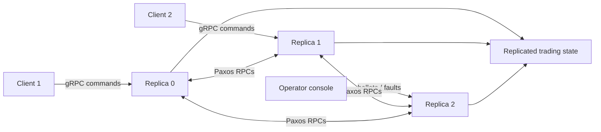

# DidaTrade

> **A replicated stock-trading service that keeps making progress while the
> cluster changes underneath it.**

[](https://www.oracle.com/java/technologies/downloads/)
[](https://grpc.io/)
[](https://en.wikipedia.org/wiki/Paxos_(computer_science))
[](https://www.docker.com/)
[](LICENSE)

DidaTrade is a distributed trading application built to make consensus
visible. Clients submit user, buy, sell, and balance operations to a replicated
cluster. Replicas agree on one ordered command log, execute the same state
machine, survive failures, and can even change the acceptor set while the
system is running.

This is not a mock distributed system hidden behind a single process. Every
replica has its own lifecycle, every RPC crosses gRPC, and the failure modes
are intentionally triggerable from an operator console.

## The idea



The application layer is intentionally small: users hold cash and stock,
orders change those balances, and reads expose the resulting state. The hard
part is making every replica reach the same answer when requests collide,
leaders change, nodes disappear, and configurations evolve.

## What makes it interesting

### Multi-Paxos for the normal path

After a leader completes phase 1, consecutive commands can be pipelined
through phase 2. Replicas execute decisions strictly in log order, turning
Paxos decisions into a deterministic trading state machine.

### Fast Paxos for low-latency proposals

Fast ballots allow clients and replicas to propose without routing every value
through a single leader. The implementation tracks votes per value, detects
collisions, and automatically raises the ballot when a fast round cannot
decide safely.

### Causal `balance` reads

`balance` is not a stale local read. Each write reply carries the log slot it
executed at, and the client sends that slot as its causal lower bound. A
lagging replica waits until it has executed the required prefix before
answering, so a client never observes state older than its own history.

### Vertical Paxos and dynamic membership

Schedules can change the acceptor set while the service is live. A completed
ballot records which values were recovered and ensures the new acceptors hold
the decided log before the configuration becomes active.

### Recovery and state transfer

A stopped replica can rejoin, fetch decided commands from its peers, replay the
missing suffix, and abstain from ballots it cannot safely participate in
after losing its promises and votes.

### Fault injection as a first-class feature

The console can crash, freeze, un-freeze, or slow a replica. These are not test
hooks around the system: they pass through the same administrative RPC surface
used for ballots and reconfiguration, making failure behavior easy to observe.

## Try the cluster

The only host dependency is Docker or Podman. Java, Maven, protoc, and the
gRPC toolchain run in a multi-architecture container.

```bash
git clone https://github.com/sousa16/padi.git
cd padi

./dev.sh build
./dev.sh up
```

Open two more terminals:

```bash
./dev.sh console
./dev.sh app
```

The client supports commands such as `populate`, `adduser`, `buy`, `sell`,
`balance`, and `dump`; type `help` in the client for the complete list.
Multiple clients must use distinct IDs:

```bash
./dev.sh app       # client 1
./dev.sh app 2     # client 2
```

## See state transfer happen

Schedule C runs seven replicas and changes its acceptor set during a later
configuration. Stop a replica, keep making trades, then restart it:

```bash
./dev.sh up C
./dev.sh app 1 C

./dev.sh stop 6
# perform more operations in the client
./dev.sh start 6
./dev.sh logs 6
```

The returning replica should fetch the decided suffix, replay it, and
reconcile with the cluster. This is the moment the project becomes tangible:
the system is not merely replicating messages; it is repairing a replica's
state after the replica missed history.

## Operate and break it

From the console, debug modes are deliberately simple:

| Mode | Command | Effect |
| --- | --- | --- |
| Normal | `debug 0 <replica>` | Clear freeze and slow mode |
| Crash | `debug 1 <replica>` | Stop the replica process |
| Freeze | `debug 2 <replica>` | Hold inbound client and Paxos requests |
| Un-freeze | `debug 3 <replica>` | Release held requests |
| Slow mode | `debug 4 <replica>` | Add random request delays |
| Slow mode off | `debug 5 <replica>` | Remove request delays |

Start a new ballot with:

```text
ballot <ballot-number> <leader>
```

Schedules provide progressively richer experiments:

| Schedule | Replicas | Use |
| --- | ---: | --- |
| `A` | 3 | Baseline Multi-Paxos and fault injection |
| `B` | 5 | Larger quorum experiments |
| `C` | 7 | Dynamic membership and state transfer |

Useful commands:

```bash
./dev.sh ps
./dev.sh logs
./dev.sh logs 2
./dev.sh stop 2
./dev.sh start 2
./dev.sh down
./dev.sh clean
```

## Architecture

```text
src/
├── contract/   Protocol Buffers and generated gRPC contracts
├── core/       Users, orders, balances, and trading state
├── configs/    Schedules A, B, and C
├── util/       Response collectors and Paxos processors
├── server/     Replica, Paxos log, state machine, and recovery
├── app/        Interactive trading client
└── console/    Ballot, reconfiguration, and fault-injection console

compose.yaml   Replica topology and shared network namespace
dev.sh         Build, run, stop, restart, and inspect the cluster
Containerfile  Java 22 + Maven runtime image
scripts/test/  Automated scenarios for schedules A, B, and C
report/        Design and implementation report
```

The replicas share a network namespace because the protocol addresses peers as
`localhost:<base-port + replica-id>`. They remain separate containers so each
replica can be stopped and restarted independently.

## Automated scenarios

The test scripts launch replicas as plain Java processes, drive clients and
the console, inject crashes and restarts, and verify that every replica
executed the same command sequence.

```bash
./dev.sh build

podman run --rm \
  -v "$PWD/src:/work/src" \
  -v "$PWD/scripts:/work/scripts" \
  -v padi_m2:/root/.m2 \
  --entrypoint bash didatrade:dev \
  /work/scripts/test/run.sh testA
```

Run `testB` and `testC` for the larger quorum and reconfiguration scenarios.
Each successful scenario ends with:

```text
OK: executed sequences agree
```

## Project milestones

- **Step 1:** debug modes and real Paxos phase 1
- **Step 2:** Multi-Paxos with pipelined phase 2
- **Step 3:** Fast Paxos with collision recovery
- **Step 4:** causally ordered `balance` reads
- **Step 5:** dynamic membership, Vertical Paxos, state transfer, and recovery

The project is implemented in Java with Maven, Protocol Buffers, and gRPC.
The container is multi-architecture, so the same workflow runs natively on
Linux amd64 and Apple Silicon arm64.

## License

Distributed under the [MIT License](LICENSE).
